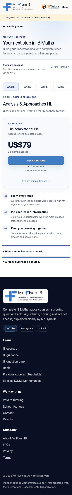
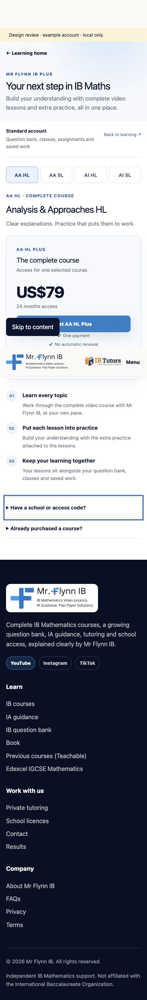

# Course access conversion review

13 November 2026. Scope: current-main source review of native course access, checkout controls, teacher access and account navigation, followed by a local render using example student states. No production analytics or customer payment sessions were inspected. Conversion improvement is a hypothesis, not a measured result.

## Findings and implementation

- The unfiltered student page repeated four course selectors and four product cards, each with a purchase action. Show one clearly selected course and one purchase action. Explicit course links take priority; otherwise show an owned course first, then the first catalogue course. Selection changes only the displayed offer, never enrollment or entitlement.
- Current access was repeated in large panels above the offer. Reduce this to a compact status row. Mark owned courses in the switcher and replace checkout with Open course for an owned selection.
- Large plan boxes, repeated descriptions and long checkout buttons obscured the price and next action. Use a restrained purchase panel with the catalogue price, access duration, short course-specific action, one-payment and no-renewal terms.
- Manual previous-purchase and access-code forms competed with buying. Keep both available as keyboard-accessible native disclosures; reopen the relevant section after submission feedback. Preserve all server actions and validation.
- Visitors needed a lower-commitment next step. Add a direct route to the selected course's sample lessons.
- The authentication redirect discarded the selected course. Preserve it inside the next destination so the offer remains relevant after sign-in.
- Teacher Plus has its own offer and eligibility. Preserve its existing checkout presentation and backend. IGCSE retains its separate routes and catalogue.

## Recommended next measurement

Compare course-access visits, sample-lesson visits, checkout starts, payment successes and activation failures by course and device. Deduplicate retries and exclude administrator/test activity. The current checkout success state is useful operational feedback but not by itself a complete conversion funnel. Do not introduce tracking identifiers or analytics dependencies as part of this visual change.

Review the new page with Rob before production publication. After approval, compare equivalent traffic periods; avoid claiming that button size alone caused any change. A later audit should cover actual landing-page-to-account drop-off and payment abandonment using verified analytics.

## Verification boundaries

Lint: zero errors, three pre-existing warnings. Production build: passed using the available Node runtime and Next webpack builder (shared local dependencies). Local example-state review does not verify a real payment, school-code redemption, migrated enrollment or authenticated account session. Production prices, entitlement enforcement and payment endpoints are unchanged.

Local browser checks passed at desktop and 390px mobile widths: no horizontal overflow at 390px; visible course-specific price and action; owned AA HL has Open course and no checkout; invalid code reopens its form; disclosure responds to click and Enter; IGCSE offer uses IGCSE course links. Mobile order places price/action before detailed benefits. Screenshots in `images/course-access-desktop.png` and `images/course-access-mobile.png` use clearly labelled example accounts. The development-only fixture was removed before the final build and is not shipped.

### Desktop example

### Mobile example

## Journey follow-up

Teacher upgrades now resolve to Teacher Plus from the lesson prompt, bootstrap account links, `/plus`, and direct student-access URLs. Checkout also redirects IB teacher/admin requests for student products to Teacher Plus before creating a Stripe session. Teacher-specific signup defaults to Teacher and cannot switch into student signup; Teacher Plus intent selects the Plus option. Generic signup retains both roles. Student dashboard and login redirects preserve course choice. Profile menus expose Standard or named Plus access with expiry/school detail. Dashboard upgrade links include price and duration.

Validation adds `node scripts/test-access-journey.mjs`, covering every IB course for student/teacher/admin, IGCSE isolation, guest course preservation, expired access and plan labels. Live authenticated payment verification and funnel analytics collection remain outstanding; no claim of measured conversion improvement is made.

## Teacher visual consistency follow-up

Teacher Plus now shares the student's compact access layout: restrained headings, four included-course labels, one US$99/12-month purchase panel and a compact Get Teacher Plus action. Existing owners receive an Open all courses action. Existing Standard classroom tools are explained separately. Authentication, entitlement lookup and Stripe checkout are retained.

Focused lint and production webpack build passed. The unpaid example was visually checked at desktop and 390px mobile widths; mobile puts the purchase panel before detailed benefits. Screenshots: `images/teacher-access-desktop.png` and `images/teacher-access-mobile.png`. The local-only preview fixture is excluded from the commit. No real payment was made.
